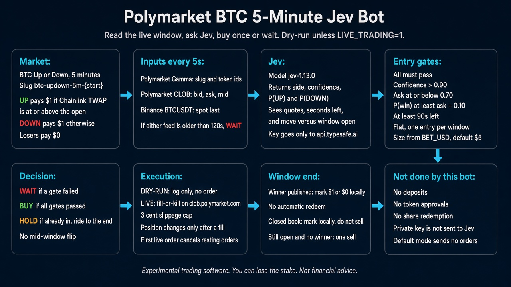

# polymarket-btc5m-jev-trading

A terminal agent for Polymarket’s BTC Up or Down 5-minute markets.

On each tick it loads the active `btc-updown-5m-{unix}` window, reads the BTC spot path, and asks [TypeSafe Jev](https://typesafe.ai) (`jev-1.13.0`) whether the window finishes UP or DOWN. The policy then abstains, or buys once and holds until Polymarket resolves the window. The default mode is dry-run: decisions are logged and no order is sent. Live trading is opt-in and posts fill-or-kill market orders.

<p align="center">
  
</p>

## What it does

Each 5-minute contract pays $1 on the winning side and $0 on the losing side. Polymarket resolves the contract from Chainlink BTC/USD TWAP against the window’s price to beat. Share prices on the book are other traders’ opinions. Jev is given that distinction, plus seconds remaining, the UP and DOWN book, and how far BTC has moved from the price recorded when this process entered the window.

The session moves through four phases:

1. **Awaiting window.** Poll Gamma until the current slug is active and has not expired.
2. **Trading.** Every `TICK_MS` (default 5 seconds), refresh the book and Binance spot, ask Jev, and apply the entry policy. At most one buy is allowed per window.
3. **Settling.** When the clock rolls, Gamma serves the next slug, or the held market closes, score the position. If Gamma outcome prices identify a winner, the held side is marked at $1 or $0. If the book is already dead and no winner is published, the position is marked at the last usable bid. A still-open book can receive one force-flatten sell.
4. **Recorded.** The result is appended to the PnL ledger. The session waits for the next slug and returns to phase 1.

An open position is held through the rest of the window. The policy does not flip sides or take profit in the middle of a window.

## Entry policy

Gates run in this order while the position is flat. The first failure abstains.

| Gate | Default | Pass condition |
|------|---------|----------------|
| Confidence | `ACT_THRESHOLD=0.90` | Jev confidence is **strictly greater** than the threshold |
| Trade count | `MAX_ENTERS_PER_WINDOW=1` | This window has not already been entered |
| Time left | `MIN_SECONDS_TO_ENTER=90` | At least 90 seconds remain |
| Ask cap | `MAX_ASK=0.70` | Best ask (or mid, if no ask) is at or below 0.70 |
| Edge | `MIN_EDGE=0.10` | P(win) ≥ ask + 0.10 |

P(win) is Jev’s probability for the chosen side. Confidence alone is not treated as edge. Share size is `floor((BET_USD / ask) × 100) / 100`, so notional stays at or under `BET_USD` (default $5).

Inputs older than `STALE_AFTER_MS` (default 120 seconds) skip the judge and abstain. A missing market, a failed judge call, or an incomplete spot sample also abstains.

## Data sources

| Input | Endpoint | Role |
|-------|----------|------|
| Market | `gamma-api.polymarket.com` | Active event, outcomes, token ids, outcome prices |
| Book | `clob.polymarket.com` (read) | Mid, spread, last trade, best bid and ask |
| Spot | `api.binance.com` BTCUSDT | Last price, 24h stats, and move versus the price captured at window open |
| Judge | TypeSafe `systemOne` | Side, confidence, and P(UP) / P(DOWN) |
| Orders | CLOB v2, only when `LIVE_TRADING=1` | FOK market buy, and a force-flatten sell if the book is still open at settlement |

`POLYMARKET_SOURCE=auto` tries the live Gamma and CLOB feeds, then sticks to `fixtures/btc-updown-active.json` for the rest of the process if a transport error occurs. Use `POLYMARKET_SOURCE=live` whenever real orders are enabled. Live mode refuses `POLYMARKET_SOURCE=fixture` and refuses `--stub-judge`.

## Requirements

- Node.js 20 or newer
- A TypeSafe API key (`TYPESAFE_API_KEY`) for any run that calls Jev

Live trading also needs a Polygon wallet that already trades on [Polymarket](https://polymarket.com): connected, funded with USDC.e, and able to place a trade in the browser. This repository does not approve tokens or move deposits.

## Install

```bash
git clone https://github.com/VGabriel45/polymarket-btc5m-jev-trading.git
cd polymarket-btc5m-jev-trading
cp .env.example .env
npm install
```

Set the API key in `.env`:

```bash
TYPESAFE_API_KEY=your_key_here
```

## Run

### Dry-run

```bash
npm run watch
```

The Ink interface opens and the status line reads **DRY-RUN**. Press `q` or `Escape` to quit. Intended orders stay in the session log. Nothing is posted to the CLOB.

One tick, as JSON on stdout:

```bash
npm run once
```

`npm run tick` is the same command.

### Offline smoke

No TypeSafe key and no live market feed. The stub judge returns a fixed side and confidence, and spot is pinned.

```bash
POLYMARKET_SOURCE=fixture npm run watch -- --stub-judge
```

Optional overrides:

```bash
npm run once -- --stub-judge --stub-side=DOWN --stub-confidence=0.95
npm run watch -- --fixed-spot
```

`--stub-judge`, `--stub-side`, and `--stub-confidence` also enable the fixed spot source.

### Live trading

1. On polymarket.com, connect the wallet this process will sign with and confirm a normal trade works.
2. Add the live block to `.env`:

```bash
LIVE_TRADING=1
WALLET_PVK=0x...
POLYMARKET_FUNDER=0x...
SIGNATURE_TYPE=3
POLYMARKET_SOURCE=live
BET_USD=5
```

3. Start the same interface:

```bash
npm run watch
```

The status line reads **LIVE TRADING**.

`SIGNATURE_TYPE` selects the CLOB v2 signer:

| Value | Type |
|-------|------|
| `0` | EOA |
| `1` | POLY_PROXY |
| `2` | POLY_GNOSIS_SAFE |
| `3` | POLY_1271 (default; typical deposit wallet) |

If `POLYMARKET_FUNDER` is omitted, the funder is resolved from Polymarket’s secure client. `POLYGON_RPC_URL` defaults to `https://polygon-bor-rpc.publicnode.com`.

On the first live order the client derives CLOB API credentials, refreshes the collateral allowance cache, and cancels resting open orders so leftover GTC orders are not left on the book. Entries and the window-end flatten are fill-or-kill market orders. The limit used for a buy is the planned price plus $0.03, capped at $0.99. A sell uses the planned price minus $0.03, floored at $0.01. An unfilled FOK does not change the position. If a fill report includes taking and making amounts, size and price are rewritten from that fill before the position and the ledger are updated.

Do not combine `LIVE_TRADING=1` with `--stub-judge` or `POLYMARKET_SOURCE=fixture`. The process exits on startup if either combination is set.

## Configuration

Values come from the environment and from `.env` (loaded by the CLI before `loadConfig`).

| Variable | Default | Effect |
|----------|---------|--------|
| `TYPESAFE_API_KEY` | — | Required unless `--stub-judge` is passed |
| `POLYMARKET_SOURCE` | `auto` | `live`, `fixture`, or `auto` |
| `BTC_UPDOWN_SLUG` | current 5m slug | Force a Gamma event slug |
| `FIXTURE_PATH` | `fixtures/btc-updown-active.json` | Fixture file for `fixture` and `auto` fallback |
| `TICK_MS` | `5000` | Delay between loop ticks |
| `ACT_THRESHOLD` | `0.90` | Minimum confidence; entry requires a value strictly above this |
| `MAX_ASK` | `0.70` | Highest ask that may be bought |
| `MIN_EDGE` | `0.10` | P(win) must clear ask by at least this amount |
| `MIN_SECONDS_TO_ENTER` | `90` | No new entry inside this many seconds of expiry |
| `MAX_ENTERS_PER_WINDOW` | `1` | Entries allowed before the policy only holds |
| `BET_USD` | `5` | Maximum USD notional of one entry |
| `STALE_AFTER_MS` | `120000` | Market or spot samples older than this abstain |
| `PNL_PATH` | `data/pnl.jsonl` | Append-only settlement ledger |
| `LIVE_TRADING` | off | `1` or `true` posts CLOB orders |
| `WALLET_PVK` | — | Signer private key; required when live |
| `POLYMARKET_FUNDER` | resolved | Deposit or proxy address that holds funds |
| `SIGNATURE_TYPE` | `3` | See the signer table above |
| `POLYGON_RPC_URL` | public Polygon RPC | RPC used to build the viem wallet client |

## Terminal

`npm run watch` renders an Ink layout from each `TickSnapshot`: window header and countdown, UP mid trail, depth, the current action (`WAIT`, `BUY`, `HOLD`, `SELL`), position and unrealized PnL, and a short event log. The view only displays snapshots. It does not fetch markets or call Jev.

## Accounting

Settlements are appended as one JSON object per line. On startup the file is summed into the cumulative figure shown in the session.

When Gamma publishes a winner, PnL is `size × (settle − entry)`, with `settle` equal to `1` if the held side won and `0` otherwise. A mark-to-bid flatten uses `size × (exitPrice − entryPrice)`. Dry-run and live records are distinguished by the `mode` field (`dry-run` or `live`).

## Scripts

```bash
npm run watch          # Ink loop
npm run once           # one tick, JSON on stdout
npm run tick           # alias of once
npm run typecheck      # tsc --noEmit
npm run smoke:policy   # offline checks of the entry gates
```

## Layout

```
src/
  cli/            watch.ts, once.ts, flags
  session.ts      window phases, tick loop, settlement
  policy.ts       abstain / enter / hold gates and order sizing
  compose.ts      freshness check and the fact object sent to Jev
  config.ts       environment wiring
  broker/         dry-run position updates and live FOK execution
  adapters/       Gamma, CLOB reads, Binance, TypeSafe, fixtures
  pnl/            jsonl ledger
  tui/            Ink interface
fixtures/         offline BTC Up/Down sample
```

Wire JSON from Gamma, the CLOB, and Binance is parsed inside the adapters. The session, policy, and interface use the domain types in `src/domain.ts`.

## Disclaimer

Experimental software. It is not financial advice, and live mode can lose money. The project is not affiliated with Polymarket or TypeSafe beyond calling their public APIs and SDKs.
